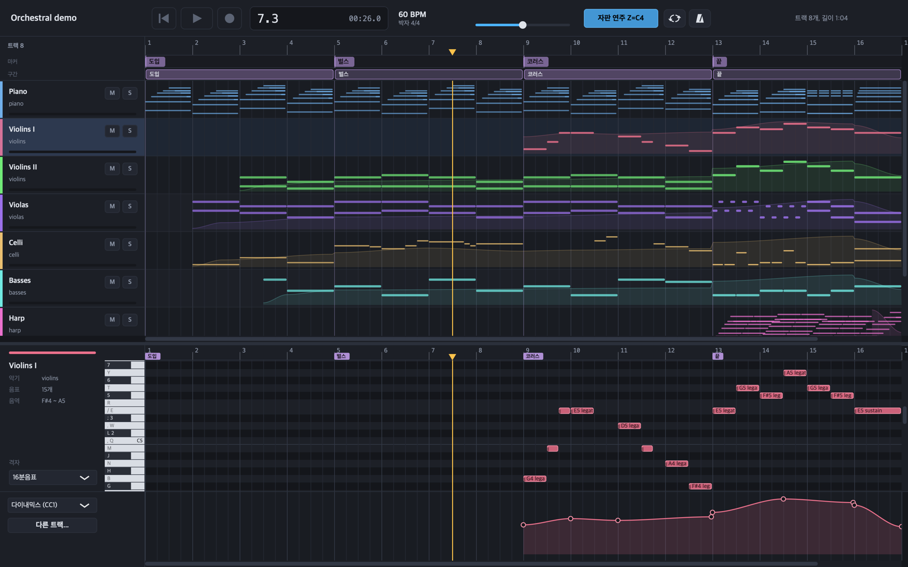
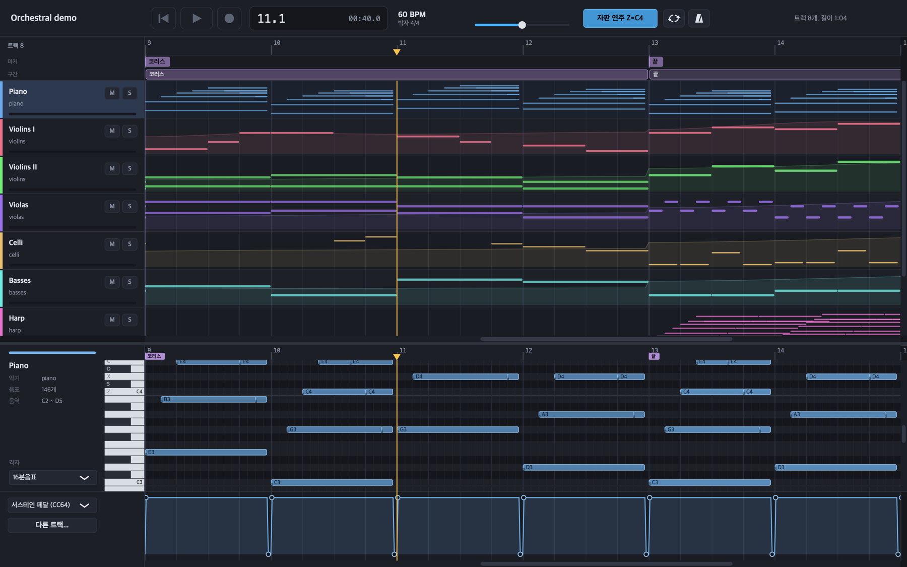
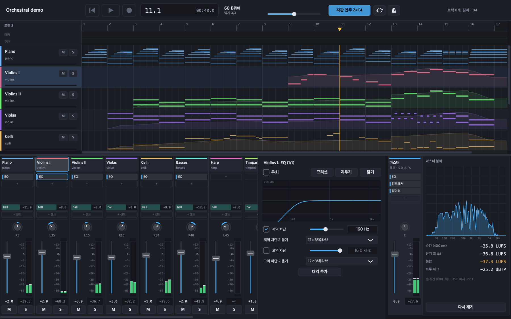
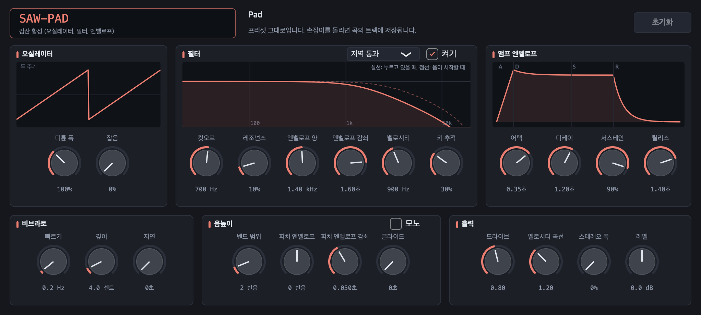
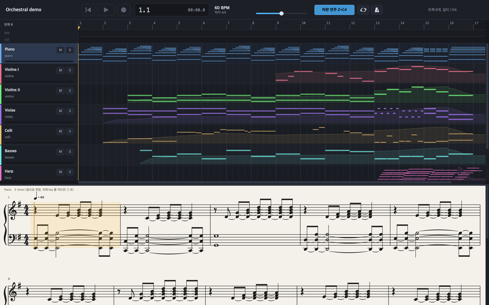
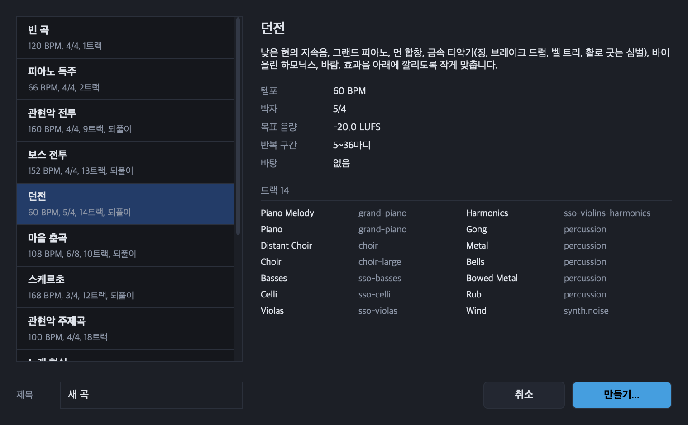
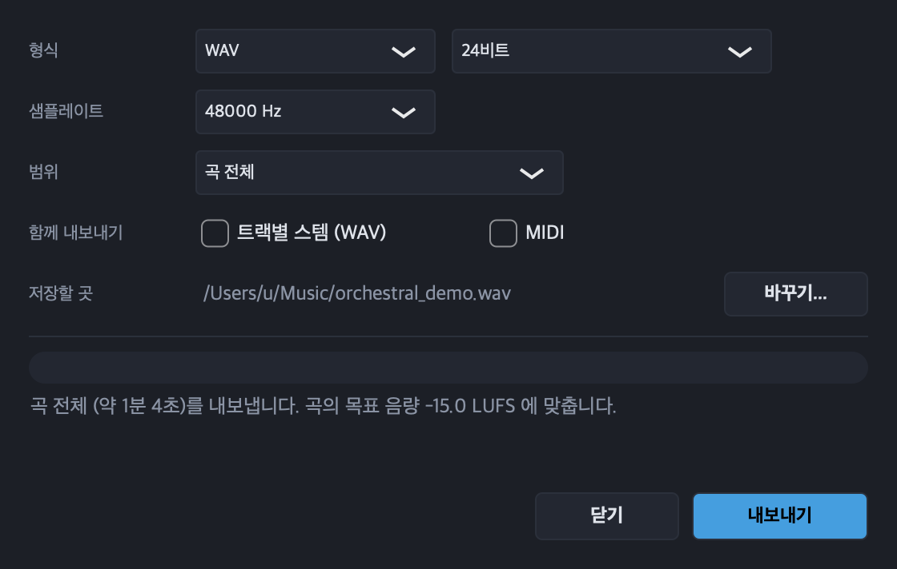

# InitialDAW

[English](README.md) | 한국어

에이전트가 음악을 만들 수 있게 설계한 DAW이자 음악 엔진입니다. 곡은 데이터 구조, 곧 JSON 파일 하나(Composition JSON)입니다. 사람은 앱에서
편집하고, 에이전트와 스크립트는 명령줄에서 곡을 읽고, 수정하고, 렌더링하고, 결과를 측정하며, 명령줄은 JSON으로 응답합니다. 어느 경로로
만들어도 같은 소리가 납니다. 화면은 한국어입니다.



| | |
| :--- | :--- |
| 상태 | 개발 초기. 아직 릴리스 빌드가 없으므로 소스에서 빌드해야 합니다 |
| 플랫폼 | macOS 11 이상 (빌드와 테스트를 macOS에서만 했습니다) |
| 사용 기술 | C++20, JUCE 8, sfizz, Signalsmith Stretch, LAME, libFLAC, libvorbis |
| 곡 형식 | Composition JSON ([스키마](engine/schemas/composition.schema.json)) |
| 라이선스 | AGPL-3.0 ([자세히](#라이선스)) |

## 기능

- **피아노 롤과 악보.** 벨로시티와 컨트롤러 레인, 드럼 키트용 드럼 보기, 우클릭 메뉴의 코드와 스케일 삽입, 음표 다듬기(세기와 스윙을
  조절하는 퀀타이즈, 휴머나이즈, 레가토, 스케일 맞추기, 아르페지오와 스트럼, 역행, 반행, 그루브), 스텝 입력, 여러 트랙 동시 편집,
  MusicXML 내보내기를 지원하는 악보 보기.
- **편곡.** 트랙, 폴더, VCA, 마커, 구간을 옮기고 복제하고 삭제하는 구간 띠, 여러 트랙에 걸친 구간 복사와 붙여 넣기, 시간 삽입과 삭제,
  템포와 박자 변경, MIDI 가져오기, 자동 저장, 실행 취소 기록.
- **오디오.** WAV, AIFF, FLAC, Ogg Vorbis, MP3 클립. 반복 녹음 테이크와 컴핑. 페이드 모양, 게인 곡선, 리버스, 크로스페이드.
  타임 스트레치, 피치 시프트, 워프 마커와 오디오 퀀타이즈. 피치 보정과 음별 피치 편집. 템포 감지, 슬라이스, 멜로디 받아 적기,
  템포 따라가기. 트랙을 오디오로 바운스.
- **악기.** sfizz로 재생하는 SFZ 샘플 라이브러리, 전용 패널이 있는 내장 신스(감산 합성 프리셋, 808, 드럼 키트), 자체 창을 여는 VST3,
  AU 플러그인, 소리 하나로 악기를 만드는 퀵 샘플러, 트랙 템플릿.
- **믹싱.** 버스, 센드, 서브그룹, VCA, 사이드체인. EQ, 컴프레서, 멀티밴드 컴프레서, 트랜지언트 셰이퍼, 디에서, 게이트, 디스토션,
  리버브, 딜레이, 필터, 덕커, 코러스, 플랜저, 페이저, 트레몰로, 스테레오, 트루 피크 리미터. VST3, AU 효과. 오토메이션 그리기와 기록.
  효과 프리셋. MIDI 배우기. 라우드니스와 스펙트럼 미터, 목표 라우드니스.
- **녹음.** 카운트인, 메트로놈, 반복 구간 오버더브와 펀치, 입력 모니터링을 지원하는 MIDI와 오디오 녹음. MIDI 키보드가 없으면
  컴퓨터 키보드로 연주할 수 있습니다.
- **영상.** 타임코드와 섬네일이 있는 영상 레인, 재생과 맞춰 움직이는 영상 창, 장면 전환 감지, 음악을 입힌 영상 내보내기.
- **내보내기.** 곡 전체, 반복 구간, 마디 범위를 WAV, FLAC, Ogg Vorbis, MP3로 저장합니다. 루프 지점이 들어간 게임용 루프 파일,
  스템, MIDI도 출력합니다. 앱의 내보내기 결과는 명령줄 렌더링과 바이트 단위로 같습니다.
- **명령줄 엔진.** `music-render`는 곡을 렌더링, 측정, 검사, 편집하고 실행마다 JSON 객체 하나를 출력합니다. 스크립트와 에이전트가
  렌더링하고 측정한 뒤 다시 시도할 수 있습니다.

모든 기능, 단축키, 명령은 [사용 설명서](docs/manual.ko.md)에 있습니다.

## 스크린샷

**피아노 롤.** 예제 곡의 피아노 파트와 서스테인 페달 레인(CC64)입니다. 위쪽 트랙 보기에 같은 마디의 모든 파트와 마커, 구간 띠가 보입니다.



**믹서.** 트랙마다 효과, 센드, 밸런스, 페이더, 미터가 있는 채널 스트립입니다. 제1바이올린의 EQ가 응답 곡선과 함께 열려 있고, 오른쪽에
마스터의 스펙트럼과 라우드니스가 있습니다.



**내장 신스.** 톱니파 패드입니다. 오실레이터, 응답 곡선이 표시되는 필터, 앰프 엔벨로프, 비브라토, 음높이, 출력 섹션이 있습니다.



**악보.** 피아노 파트를 큰보표로 표시합니다. 음표로 추정한 조표, 박에 맞춘 빔, 붙임줄이 보입니다.



**새 곡과 내보내기.** 장르 템플릿으로 새 곡을 만드는 대화상자와 내보내기 대화상자입니다.





## 시작하기

macOS 11 이상, Xcode 명령줄 도구, CMake 3.22 이상, Python 3가 필요합니다.

```bash
git clone https://github.com/biud436/InitialDAW.git
cd InitialDAW
./build.sh               # 라이브러리를 external/에 내려받고, 앱과 엔진을 빌드하고, 테스트를 실행합니다
./build.sh --samples     # 샘플 라이브러리(아래 표)도 내려받습니다
./build.sh --gugak       # 국악기 녹음도 내려받습니다 (국립국악원이 요구하는 사용 목적을 입력받습니다)
./build.sh --plugins     # 무료 FM 신스 Dexed(VST3, AU)도 내려받습니다. 악기 이름은 dexed입니다
./build.sh --no-test     # 빌드만 합니다
open build/app/InitialDAW_artefacts/Release/InitialDAW.app
```

`build.sh`는 JUCE 8.0.10, sfizz, LAME 4.0, libFLAC, libogg, libvorbis, Signalsmith Stretch, 악보 글꼴 Bravura를 고정된 태그, 커밋,
SHA-256으로 내려받으며 저장소에는 포함하지 않습니다. PATH에 있는 cmake가 3.22보다 낮으면 `python3 -m pip install --user 'cmake<4'`로
설치한 cmake를 찾아 사용합니다.

샘플 라이브러리는 선택 사항입니다. 내려받지 않으면 샘플 악기는 각각 대체 내장 신스로 재생됩니다.
국립국악원 사이트는 내려받을 때마다 사용 목적 양식(상업용도 구분, 사용용도, 소속)을 요구합니다. 그래서 `--gugak`은 이 값을 입력받거나
`GUGAK_USE_TYPE`, `GUGAK_USE_PURPOSE`, `GUGAK_AFFILIATION`에서 읽으며, 값이 없으면 아무것도 보내지 않습니다.

| 라이브러리 | 크기 | 라이선스 |
| :--- | ---: | :--- |
| VSCO 2 Community Edition (관현악, 업라이트 피아노, 타악기) | 2.8GB | CC0 |
| Sonatina Symphonic Orchestra 일부 (현악, 목관, 금관, 합창, 그랜드 피아노) | 560MB | CC Sampling Plus 1.0 |
| FreePats: 스페인 클래식 기타, MuldjordKit 드럼, 일렉트릭 베이스, 일렉트릭 기타, 테너 색소폰 | 774MB | CC0, MuldjordKit은 CC BY 4.0 |
| Karoryfer x bigcat 첼로 | 133MB | CC0 |
| 국립국악원 녹음 (가야금, 해금, 대금, 장구, 아쟁, 징), `--gugak`으로만 | 490MB | 공공누리 제1유형 |

파일 > 새 곡(⌘N)에서 13개 장르 템플릿 중 하나로 곡을 시작하거나, `engine/examples/`의 예제 곡을 엽니다. 화면 구성과 단축키는
[사용 설명서](docs/manual.ko.md)에 있습니다.

## 곡 형식

곡에는 트랙, 음표, 버스, 마스터가 들어갑니다. 박은 4분음표 단위이고, 음높이는 MIDI 번호나 음 이름으로 적습니다.

```json
{
  "tempo": 76,
  "performance": { "timingHumanizeMs": 12, "velocityHumanize": 8, "humanizeSeed": 12345 },
  "tracks": [
    { "name": "Violins", "instrument": "violins", "mixer": { "gainDb": -3, "pan": -0.4 },
      "sends": [ { "bus": "hall", "levelDb": -9 } ],
      "cc1": [ { "beat": 0, "value": 30 }, { "beat": 8, "value": 100, "curve": "smooth" } ],
      "notes": [ { "pitch": "E4", "startBeat": 0, "durationBeat": 4, "velocity": 70, "articulation": "legato" },
                 { "pitch": "B3", "startBeat": 4, "durationBeat": 0.5, "velocity": 80, "articulation": "pizzicato" } ] }
  ],
  "buses": [ { "name": "hall", "effects": [ { "type": "reverb", "mix": 1, "decaySeconds": 2.6, "preDelayMs": 25 } ] } ],
  "master": {
    "targetLufs": -16,
    "effects": [ { "type": "eq", "lowCutHz": 30 }, { "type": "compressor", "thresholdDb": -18, "ratio": 2 },
                 { "type": "limiter", "ceilingDb": -1 } ]
  }
}
```

앱은 편집하지 않는 내용(주석, 모르는 필드, 키 순서)을 그대로 두고 음표를 한 줄에 하나씩 저장하므로, 편집한 곡의 diff를 읽기 쉽습니다.
악기 이름을 무엇으로 재생할지(내장 신스, SFZ 파일, VST3 플러그인, AU)는 레지스트리([engine/instruments/registry.json](engine/instruments/registry.json))가
정합니다.

## 명령줄

```bash
MR=build/engine/music-render
$MR validate song.json                                   # JSON 경로가 붙은 오류와 경고
$MR render song.json --output song.mp3                   # .wav .flac .ogg .mp3, --stems, --bars 17-32, --loop
$MR render song.json --output song.wav --measure m.json  # 렌더링하면서 마디, 대역, 트랙별 레벨을 측정합니다
$MR inspect song.wav                                     # 길이, 피크, 트루 피크, LUFS, 클리핑
$MR arrange song.json insert-bars --at 17 --count 4      # 앱의 편곡 편집을 곡 파일에 적용합니다
$MR import-midi sketch.mid --output sketch/sketch.json   # 표준 MIDI 파일을 새 곡으로
$MR export-musicxml song.json --output song.musicxml     # 악보
$MR new orchestral-battle --output storm/storm.json --title "Storm"   # 템플릿으로 새 곡
$MR realtime song.json --from 60 --seconds 15            # 실시간 재생기를 돌려 부하를 측정합니다
```

모든 명령은 표준 출력에 JSON 객체 하나를, 표준 오류에 로그를 출력합니다. 종료 코드는 성공 0, 잘못된 입력이나 렌더링 실패 1,
사용법 오류 2입니다. 전체 명령은 [사용 설명서](docs/manual.ko.md#음악-엔진music-render)에, 엔진 설계는
[docs/plans/engine.md](docs/plans/engine.md)에 있습니다.

## 폴더 구조

| 폴더 | 내용 |
| :--- | :--- |
| `engine/` | 음악 엔진: 곡 모델, 연주 처리, 악기, 믹서, 효과, 오프라인 렌더러, 실시간 재생기, 명령줄, 테스트 |
| `app/` | DAW: 트랙 보기, 피아노 롤, 악보, 믹서, 악기 패널, 녹음, 내보내기 |
| `templates/` | 새 곡의 장르 템플릿 |
| `tools/` | Music IR, 건반 보정, 게임용 루프 파일, 배치 명세, 템플릿과 SFZ 생성기, 라이선스 문서 모으기 |
| `docs/` | [사용 설명서](docs/manual.ko.md), 계획과 진행 상황(`docs/plans/`) |
| `external/` | `build.sh`가 내려받는 라이브러리와 샘플 (저장소에 포함하지 않음) |

## 향후 계획

노이즈 제거, 컨볼루션 효과와 피치 시프터, 사운드 브라우저, 드럼 녹음을 음표로 변환, 코드 트랙, 트랙 프리즈, 마스터링 미터와 디더,
모듈레이터, 외부 MIDI 장치, 악보에서 편집을 계획하고 있습니다([docs/plans/next-stages.md](docs/plans/next-stages.md)). 다른 사람의
녹음으로 학습한 모델이 필요한 기능(음원 분리 등)은 의도적으로 넣지 않습니다.

## 라이선스

- **코드:** GNU Affero General Public License 3판(AGPL-3.0-only, [LICENSE](LICENSE)). JUCE의 오픈 소스 라이선스와 같습니다.
  Copyright (C) 2026 biud436. 저장소 전체에 적용됩니다. 사용, 수정, 배포할 수 있지만, 이 코드를 포함한 프로그램을 배포할 때는
  수정 여부와 상관없이 AGPLv3로 소스와 함께 공개해야 합니다.
- **AI 사용:** 코드의 상당 부분은 저자의 지시에 따라 Anthropic의 Claude와 함께 작성했습니다. Claude가 참여한
  커밋에는 `Co-Authored-By: Claude` 줄이 있습니다.
- **실행 파일:** 앱과 `music-render`도 소스와 같이 AGPLv3로 배포합니다. JUCE 8(AGPLv3 또는 JUCE 상용 라이선스)과 MP3 인코더
  LAME(LGPL-2.0 이상)을 링크하고, 악보 보기에 쓰는 글꼴 Bravura(SIL OFL 1.1)를 앱에 포함합니다.
- **샘플:** Sonatina Symphonic Orchestra(CC Sampling Plus 1.0)로 만든 곡은 출처를 밝혀야 하고, 광고에는 그 곡 자체를 홍보하는 경우에만
  사용할 수 있습니다. 국립국악원 녹음(공공누리 제1유형)으로 만든 곡도 출처를 밝혀야 하며, 문구는 [THIRD-PARTY.md](THIRD-PARTY.md)에
  있습니다. MuldjordKit(CC BY 4.0)은 "MuldjordKit by Lars Muldjord" 표기를 요청합니다. 샘플은 저장소와 릴리스에 포함하지 않습니다.

제3자 구성 요소와 라이선스는 [THIRD-PARTY.md](THIRD-PARTY.md)에 정리되어 있습니다. 릴리스 압축 파일에 넣을 라이선스 문서는 다음 명령으로
모읍니다.

```bash
tools/collect-licenses.sh dist/licenses   # ./build.sh로 내려받은 external/이 있어야 합니다
```
