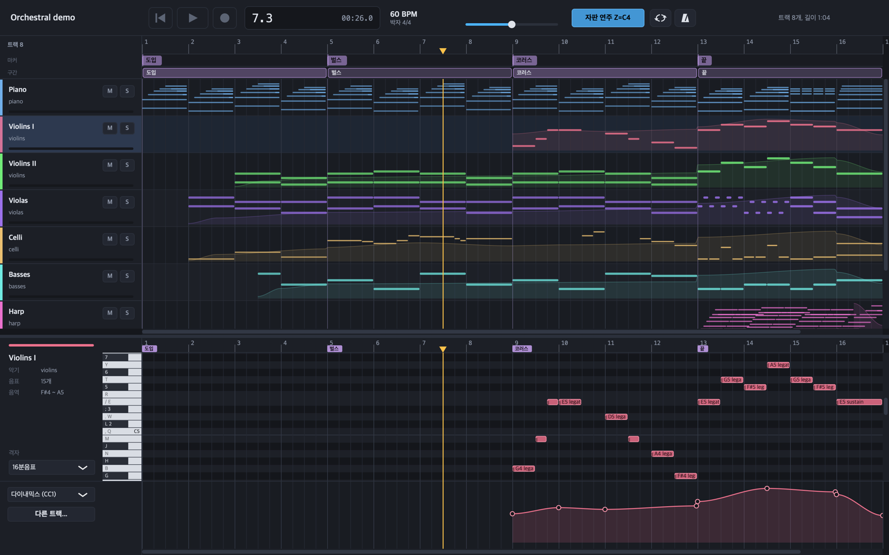
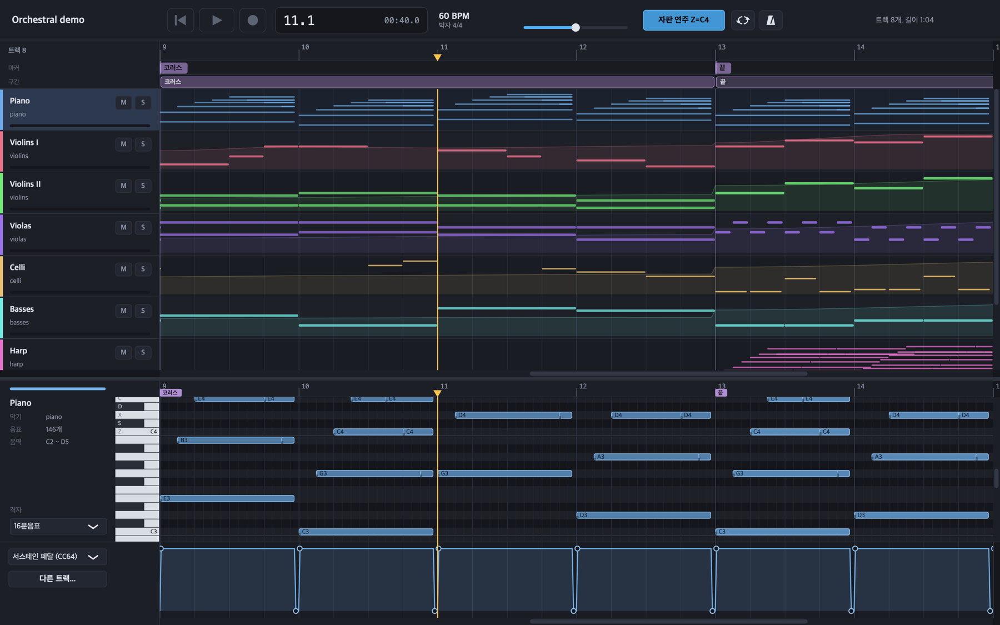
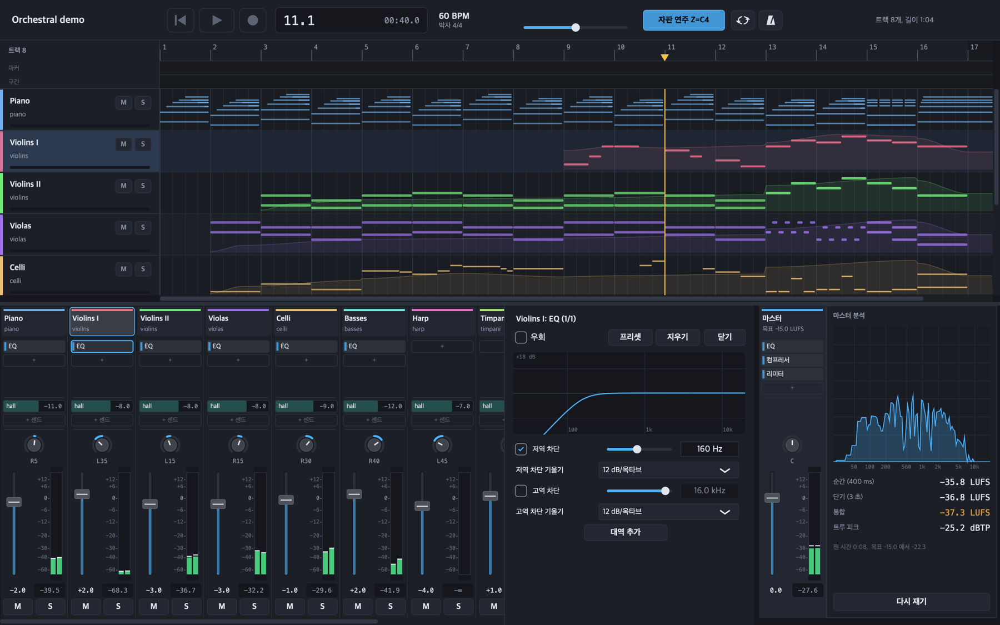
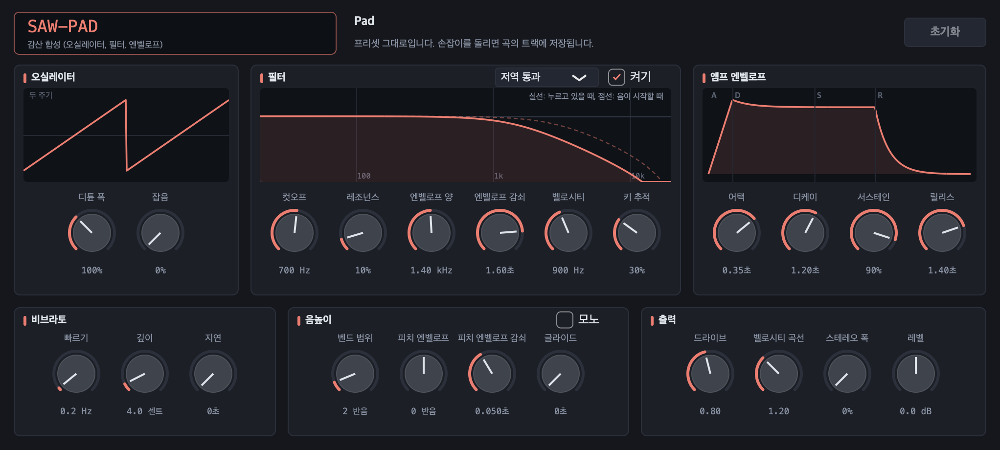
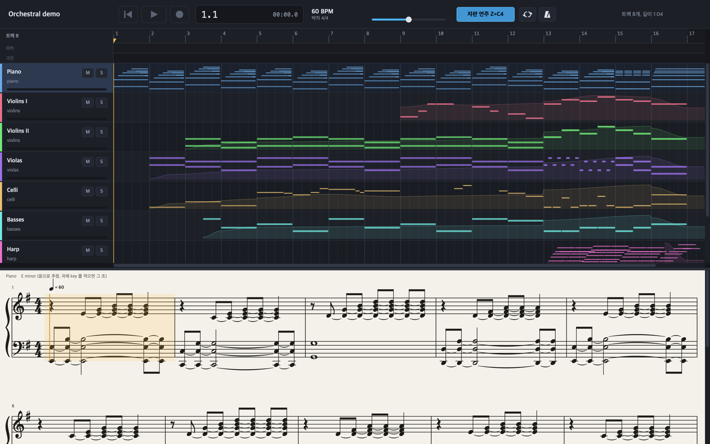
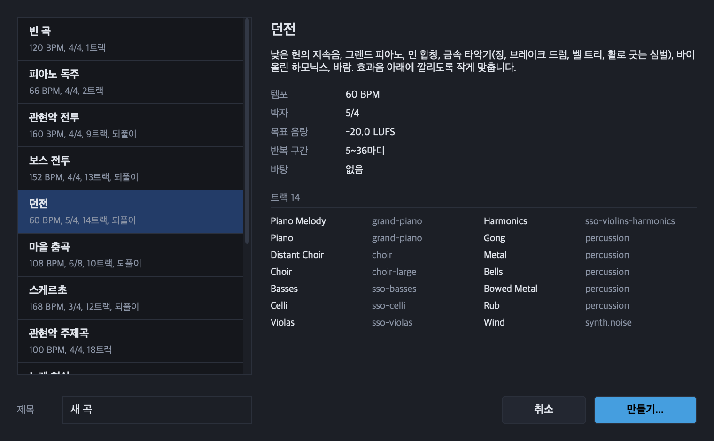
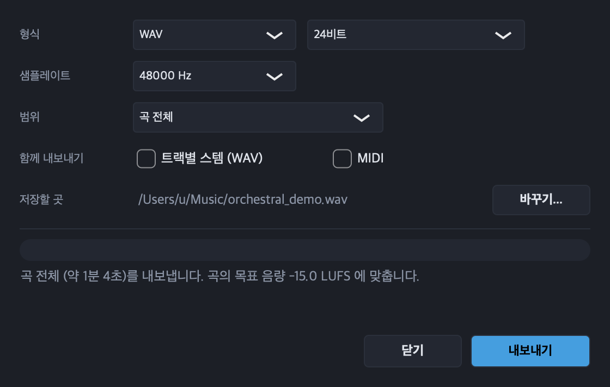

# InitialDAW

English | [한국어](README.ko.md)

A DAW and music engine built so that agents can make music. A song is a data structure, one JSON file (Composition JSON):
people edit it in the app, and agents and scripts read it, change it, render it and measure the result from the command
line, which answers in JSON. Every route gives the same sound. The interface is in Korean.



| | |
| :--- | :--- |
| Status | Early development. There are no release builds yet; build it from source |
| Platform | macOS 11 or later (the only platform built and tested) |
| Built with | C++20, JUCE 8, sfizz, Signalsmith Stretch, LAME, libFLAC, libvorbis |
| Song format | Composition JSON ([schema](engine/schemas/composition.schema.json)) |
| License | AGPL-3.0 ([details](#license)) |

## Features

- **Piano roll and score.** Velocity and controller lanes, a drum view for kits, chords and scales from the right-click
  menu, note tools (quantize with strength and swing, humanize, legato, scale snap, arpeggios and strums, retrograde,
  inversion, grooves), step input, several tracks edited at once, and a score view with MusicXML export.
- **Arrangement.** Tracks, folders and VCAs, markers, a section strip that moves, duplicates and deletes sections, range
  copy and paste across tracks, inserting and deleting time, tempo and meter changes, MIDI import, autosave and an undo
  history.
- **Audio.** Clips from WAV, AIFF, FLAC, Ogg Vorbis and MP3; recording with loop takes and comping; fade shapes, gain
  curves, reverse and crossfades; stretching, pitch shifting, warp markers and audio quantize; pitch correction and
  per-note pitch editing; tempo detection, slicing, melody transcription and tempo following; bouncing a track to audio.
- **Instruments.** SFZ sample libraries through sfizz, a built-in synth with its own panel (subtractive presets, an 808,
  drum kits), VST3 and AU plugins in their own windows, a quick sampler that turns one sound into an instrument, and track
  templates.
- **Mixing.** Buses, sends, subgroups, VCAs and sidechains; EQ, compressor, multiband compressor, transient shaper,
  de-esser, gate, distortion, reverb, delay, filter, ducker, chorus, flanger, phaser, tremolo, stereo and a true-peak limiter; VST3 and
  AU effects; drawn and recorded automation; effect presets; MIDI learn; loudness and spectrum meters and a loudness
  target.
- **Recording.** MIDI and audio with count-in, metronome, loop overdub and punch, and input monitoring. The computer
  keyboard plays notes when no MIDI keyboard is attached.
- **Video.** A video lane with timecode and thumbnails, a video window in sync with playback, scene change detection, and
  export of the music onto the video.
- **Export.** WAV, FLAC, Ogg Vorbis and MP3 of the whole song, the loop or a range of bars; game loop files with loop
  points; stems and MIDI. The app's export is byte for byte the command line render.
- **Command line engine.** `music-render` renders, measures, validates and edits songs and prints one JSON object per
  run, so scripts and agents can render a song, measure it and try again.

The [manual](docs/manual.md) describes every feature, key and command.

## Screenshots

**Piano roll.** The piano part of the example song with its sustain pedal lane (CC64); the track view above shows every
part of the same bars, with the marker and section strips.



**Mixer.** A channel strip per track with effects, sends, balance, fader and meter, the first violins' EQ open with its
response, and the master's spectrum and loudness on the right.



**Built-in synth.** A saw pad: oscillator, filter with its response, amp envelope, vibrato, pitch and output.



**Score.** The piano part on a grand staff, with the key signature estimated from the notes, beams by the beat and ties.



**New song and export.** Genre templates for a new song, and the export dialog.





## Getting started

You need macOS 11 or later, the Xcode command line tools, CMake 3.22 or later and Python 3.

```bash
git clone https://github.com/biud436/InitialDAW.git
cd InitialDAW
./build.sh               # fetch the libraries into external/, build the app and the engine, run the tests
./build.sh --samples     # also fetch the sample libraries (below)
./build.sh --plugins     # also fetch the free Dexed FM synth (VST3 and AU) for the `dexed` instrument
./build.sh --no-test     # build only
open build/app/InitialDAW_artefacts/Release/InitialDAW.app
```

`build.sh` downloads JUCE 8.0.10, sfizz, LAME 4.0, libFLAC, libogg, libvorbis, Signalsmith Stretch and the Bravura music
font, pinned to a tag, a commit or a SHA-256, and never commits them. If the `cmake` on your PATH is older than 3.22, it
looks for one installed with `python3 -m pip install --user 'cmake<4'`.

The sample libraries are optional. Without them, every sample instrument plays its built-in synth fallback.

| Library | Size | License |
| :--- | ---: | :--- |
| VSCO 2 Community Edition (orchestra, upright piano, percussion) | 2.8 GB | CC0 |
| Sonatina Symphonic Orchestra, part (strings, winds, brass, choir, grand piano) | 560 MB | CC Sampling Plus 1.0 |
| FreePats: Spanish classical guitar, MuldjordKit drums, electric bass, electric guitars, tenor saxophone | 774 MB | CC0, MuldjordKit CC BY 4.0 |
| Karoryfer x bigcat cello | 133 MB | CC0 |
| National Gugak Center recordings (gayageum, haegeum, daegeum, janggu, ajaeng, jing) | 490 MB | KOGL Type 1 |

Start a song with File > New song (⌘N), which offers 13 genre templates, or open an example from `engine/examples/`. The
[manual](docs/manual.md) explains the screen and the keys.

## Song format

A song names its tracks, notes, buses and master. Beats are quarter notes, and pitches are MIDI numbers or note names.

```json
{
  "tempo": 76,
  "performance": { "timingHumanizeMs": 12, "velocityHumanize": 8, "humanizeSeed": 12345 },
  "tracks": [
    { "name": "Violins", "instrument": "violins", "mixer": { "gainDb": -3, "pan": -0.4 },
      "sends": [ { "bus": "hall", "levelDb": -9 } ],
      "cc1": [ { "beat": 0, "value": 30 }, { "beat": 8, "value": 100, "curve": "smooth" } ],
      "notes": [ { "pitch": "E4", "startBeat": 0, "durationBeat": 4, "velocity": 70, "articulation": "legato" },
                 { "pitch": "B3", "startBeat": 4, "durationBeat": 0.5, "velocity": 80, "articulation": "pizzicato" } ] }
  ],
  "buses": [ { "name": "hall", "effects": [ { "type": "reverb", "mix": 1, "decaySeconds": 2.6, "preDelayMs": 25 } ] } ],
  "master": {
    "targetLufs": -16,
    "effects": [ { "type": "eq", "lowCutHz": 30 }, { "type": "compressor", "thresholdDb": -18, "ratio": 2 },
                 { "type": "limiter", "ceilingDb": -1 } ]
  }
}
```

The app keeps what it does not edit (comments, unknown fields, key order) and writes one note per line, so a diff of an
edited song stays readable. The registry ([engine/instruments/registry.json](engine/instruments/registry.json)) decides
what plays each instrument name: the built-in synth, an SFZ file, a VST3 plugin or an AU.

## Command line

```bash
MR=build/engine/music-render
$MR validate song.json                                   # errors and warnings with JSON paths
$MR render song.json --output song.mp3                   # .wav .flac .ogg .mp3; --stems, --bars 17-32, --loop
$MR render song.json --output song.wav --measure m.json  # levels per bar, band and track while rendering
$MR inspect song.wav                                     # length, peak, true peak, LUFS, clipping
$MR arrange song.json insert-bars --at 17 --count 4      # the app's arrangement edits on a song file
$MR import-midi sketch.mid --output sketch/sketch.json   # a standard MIDI file as a new song
$MR export-musicxml song.json --output song.musicxml     # the score
$MR new orchestral-battle --output storm/storm.json --title "Storm"   # a new song from a template
$MR realtime song.json --from 60 --seconds 15            # run the real-time player and report its load
```

Each command prints one JSON object on standard output and logs on standard error; the exit code is 0 for success, 1 for
invalid input or a failed render and 2 for a usage error. The [manual](docs/manual.md#music-engine-music-render) lists
every command, and [docs/plans/engine.md](docs/plans/engine.md) has the engine's design (in Korean).

## Repository layout

| Folder | Contents |
| :--- | :--- |
| `engine/` | the music engine: song model, performance, instruments, mixer, effects, offline renderer, real-time player, command line, tests |
| `app/` | the DAW: track view, piano roll, score, mixer, instrument panels, recording, export |
| `templates/` | genre templates for new songs |
| `tools/` | Music IR, key calibration, game loop files, placement sheets, template and SFZ generators, licence collection |
| `docs/` | the [manual](docs/manual.md), plans and progress (`docs/plans/`, in Korean) |
| `external/` | libraries and samples fetched by `build.sh` (not committed) |

## Roadmap

The planned stages are noise reduction, a convolution effect and a pitch shifter, a sound browser, drum
audio to notes, a chord track, track freezing, mastering meters and dither, modulators, external MIDI devices and editing
in the score ([docs/plans/next-stages.md](docs/plans/next-stages.md), in Korean). Features that need models trained on
other people's recordings, such as stem separation, are left out on purpose.

## License

- **Code:** GNU Affero General Public License version 3 (AGPL-3.0-only, [LICENSE](LICENSE)), the same licence JUCE is
  offered under. Copyright (C) 2026 biud436. This covers everything in the repository. You may use,
  change and share it, but programs you distribute that contain this code, changed or not, must be released under the
  AGPLv3 with their source.
- **AI use:** much of the code was written with Anthropic's Claude under the author's direction; the commits it took part in carry a `Co-Authored-By: Claude` line.
- **Binaries:** the app and `music-render` are distributed under the AGPLv3 like the source. They link JUCE 8 (AGPLv3 or
  the commercial JUCE licence) and the LAME MP3 encoder (LGPL-2.0 or later), and embed the Bravura music font (SIL OFL
  1.1) for the score view.
- **Samples:** Sonatina Symphonic Orchestra (CC Sampling Plus 1.0) must be credited in music made with it, which may be
  advertised only as that music itself. The National Gugak Center recordings (KOGL Type 1) must be credited in music made
  with them; [THIRD-PARTY.md](THIRD-PARTY.md) has the wording. MuldjordKit (CC BY 4.0) asks for "MuldjordKit by Lars
  Muldjord". No sample is part of the repository or of a release.

Every third-party component and its licence is listed in [THIRD-PARTY.md](THIRD-PARTY.md). To gather the licence texts
for a release archive:

```bash
tools/collect-licenses.sh dist/licenses   # needs external/ from ./build.sh
```
